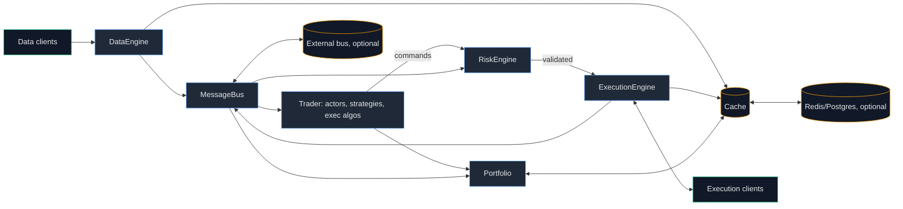
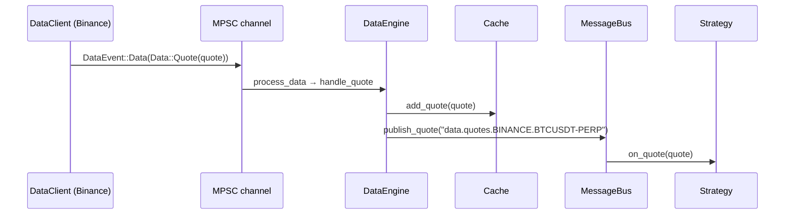
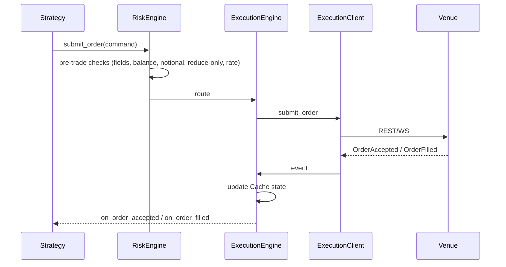

# NautilusTrader v2 — architecture, read from source

Source of truth for this document: a shallow clone of `nautechsystems/nautilus_trader` on branch `develop`
at commit **`ee642cc`** ("Use explicit terms for simulated option expiry"), plus the repository's own
`docs/concepts/architecture.md`, `MIGRATION_V2.md`, and `docs/getting_started/installation.md`.
Anything not from those files is labelled.

## Status first (this changes every summary you have read)

| Fact | Value |
|---|---|
| Repository | `nautechsystems/nautilus_trader` — **LGPL-3.0**, 31,734★, pushed 2026-11-22 |
| What `develop` is | **v2.0.0** — "Production-grade Rust-native trading engine with deterministic event-driven architecture" |
| What you get from `pip install nautilus_trader` today | **1.231.0** (stable, Cython/Python core, `requires-python >=3.12,<3.15`) |
| What you get with `pip install --pre nautilus_trader` | **2.0.0rc9** (release candidate; wheels for Python 3.13–3.15) |
| Python for v2 | `>=3.13,<3.16` |
| Platforms (v2 wheels) | Linux x86_64/ARM64 (Ubuntu 22.04+, glibc ≥ 2.35), macOS 15+ ARM64, **Windows Server 2022+ x86_64** |
| v1 support after cutover | `develop_v1` receives only critical security backports for ~3 months, no features |

> Practical consequence: **all four LLM answers audited in `01-*/FACTCHECK.md` describe v1** ("Python core with
> a Rust core for some parts"). In v2 the core *is* Rust and the Python package is a facade.

## The 30-second mental model

One **kernel** owns a single-threaded event-driven core; **adapters** are ports at the edges; **everything that
happens is a message** on a thread-local `MessageBus`; the same kernel runs **backtest, sandbox, and live** nodes
with a different clock and different clients. Strategies are actors with a lifecycle. State lives in an in-memory
`Cache` (optionally backed by Redis/Postgres) and, for durable history, an event store.

## Size and shape of the codebase (measured on the clone)

| Crate | LOC (`.rs`) | Role |
|---|---|---|
| `crates/adapters` (21 modules) | 1,415,020 | venue/broker/data integrations |
| `crates/model` | 210,604 | domain types: instruments, accounts, orders, positions, market data |
| `crates/common` | 152,213 | cache, message bus, clocks, actors/components, logging |
| `crates/execution` | 136,008 | order execution, emulation, reconciliation |
| `crates/live` | 104,423 | live node, reconciliation manager |
| `crates/data` | 82,223 | data engine, aggregation |
| `crates/persistence` | 59,215 | catalogs, database backings |
| `crates/backtest` | 53,332 | backtest engine + exchange simulation |
| `crates/network` | 51,191 | transports, TLS |
| `crates/trading` | 43,541 | strategies, execution algorithms |
| `crates/event_store` | 42,026 | event-sourced state |
| `crates/serialization` | 41,156 | schema/encoding for model + events |
| `crates/portfolio` | 28,731 | accounting, PnL, exposure |
| `crates/risk` | 24,089 | pre-trade controls, trading state |
| `crates/core` | 24,008 | time, strings, runtime primitives |
| `crates/indicators` | 21,136 | technical indicators |
| `crates/testkit` | 14,939 | test support |
| **total Rust** | **≈2.57 M** | 3,087 files |
| **Python facade** | **≈100 k** | 271 files under `python/nautilus_trader/` |

Adapter share of the Rust tree is large because each venue carries its own schemas, signing, and instrument
parsing — `binance` alone is ~180 k LOC. Do not read that as core complexity.

## Runtime composition



- **`NautilusKernel`** (crate `nautilus-system`) initialises and owns cache, portfolio, engines, trader, clock, and messaging; one lifecycle boundary for the whole node.
- **`MessageBus`** does pub/sub, request/response, and point-to-point command/event delivery with typed endpoints; optional external backing (e.g. Redis) for live transport only — durable recovery belongs to cache/event store.
- **`Cache`** holds instruments, accounts, orders, positions; indexed reads for components; optional persistence.
- **`DataEngine`** routes quotes/trades/bars/books/custom data, owns subscription reference counting (a subscription lives until the **final** owner releases it, keeping the original route for the final unsubscribe).
- **`ExecutionEngine`** routes commands, tracks order/position state, applies fills, handles reconciliation events.
- **`RiskEngine`** validates fields, balances, quantities, notionals, reduce-only, trading state, and applies rate limits; failures produce `OrderDenied` and the order never reaches the venue.
- **`Portfolio`** derives balances/positions/margin/realised+unrealised PnL/exposure from account, order, position, quote, bar, and mark-price events.
- **`Trader`** registers actors/strategies/exec algorithms and manages their lifecycle, clocks, and subscriptions.

## Threading model (the design decision that explains the rest)

- **One thread** consumes and dispatches messages: message bus, actor callbacks, strategy logic, order management, risk checks, cache reads/writes. Serial processing is what makes state transitions deterministic — the docs cite LMAX as the reference pattern.
- **Background work** runs on separate threads or a process-wide multi-threaded Tokio runtime: WebSocket/REST clients, logging worker, Redis/Postgres writes, DataFusion query futures.
- **Bridge:** async producers send events through MPSC channels; the node runner receives them and dispatches on the core thread through the **thread-local** bus. Each thread has its own bus instance.
- **One node per process.** Two `BacktestNode`/`LiveNode` instances concurrently in one process is explicitly unsupported (global logger mode, thread-local registries, shared Tokio runtime). Sequential nodes are fine if the previous one is disposed and dropped. For parallelism: separate processes, or multiple strategies in one node.

## Data flow — life of a quote tick



Subtlety worth knowing before you build on it: cache insertion is attempted **before** publication; a
persistence error is logged but does not block the in-memory insert; and **a callback can observe newer cache
state than the event it is handling** (including during synchronous re-entry). Delivery order is not an
event-time snapshot. Order-book deltas and depth snapshots bypass this path and are published directly, with
book state maintained by `BookUpdater` subscriptions.

## Order flow — life of an order



Fill events additionally drive position and portfolio updates. Failure path: a failed risk check yields
`OrderDenied` to the strategy; the venue is never contacted.

## Component lifecycle (why "degrade" and "fault" exist)

Types implementing the `Component` trait run a finite state machine:
`PRE_INITIALIZED → READY → STARTING → RUNNING → STOPPING → STOPPED → {RESETTING|RESUMING|DISPOSING}` plus
`DEGRADED` (may not meet full spec) and `FAULTED` (shut down after a detected fault). Transitional states cover
the matching callback and should stay brief; a failing callback halts the component in its transitional state.
A failed `on_dispose` moves it to `FAULTED` so it can still be retired.

Two traits, deliberately separate:

| Trait | Provides | Implemented by |
|---|---|---|
| `Actor` | `handle(message)` + registry dispatch by actor ID (`ActorRef` guards) | strategies, throttlers |
| `Component` | lifecycle: register/initialize/start/stop/resume/reset/dispose/degrade/fault | strategies, exec algorithms, `Trader` |

The docs are blunt about the aliasing hazard: actor registry handles are `Rc<UnsafeCell<…>>`; get, use and drop
an `ActorRef` inside one synchronous scope, never across an `.await`.

## Crash-only design

Release builds **abort on panic** rather than limping on with invalid state; an external supervisor restarts the
process, and normal startup handles recovery from configured cache/event-store backings. Graceful `stop`/`dispose`
still runs in normal operation. Execution reconciliation — not blind retry — handles the "did my order reach the
venue?" boundary, because venue commands are not safe to retry blindly.

## Backtest / sandbox / live parity

| Environment context | Data | Execution |
|---|---|---|
| `Backtest` | historical | simulated exchange + fee/fill models |
| `Sandbox` | real-time | simulated execution |
| `Live` | real-time | real venue connections (paper or real account) |

All three share the same `NautilusKernel` struct — same cache, portfolio, engines, trader, clock, messaging. That
is the actual meaning of "backtest-live parity": the strategy's code path is identical, only the clock and the
clients differ.

## Python surface (v2)

Strategies subclass `Strategy`, configs subclass `StrategyConfig` with **keyword-only `__init__` args** and
`**_kwargs` forwarded to `super().__init__()` (v2 configs are Rust/PyO3 types, not msgspec structs). Real
example from `docs/tutorials/ema_cross.py`:

```python
from nautilus_trader.config import StrategyConfig
from nautilus_trader.indicators import ExponentialMovingAverage
from nautilus_trader.model import Bar, BarType, InstrumentId, OrderSide
from nautilus_trader.trading import Strategy


class EMACrossConfig(StrategyConfig):
    def __init__(
        self, *, instrument_id: InstrumentId, bar_type: BarType, trade_size: Decimal,
        fast_ema_period: int = 10, slow_ema_period: int = 20, **_kwargs: object,
    ) -> None:
        super().__init__()
        self.instrument_id = instrument_id
        self.bar_type = bar_type
        self.trade_size = trade_size
        self.fast_ema_period = fast_ema_period
        self.slow_ema_period = slow_ema_period


class EMACross(Strategy):
    def __init__(self, config: EMACrossConfig) -> None:
        super().__init__(config)
        self.fast_ema = ExponentialMovingAverage(config.fast_ema_period)
        self.slow_ema = ExponentialMovingAverage(config.slow_ema_period)

    def on_start(self) -> None:
        self.register_indicator_for_bars(self.config.bar_type, self.fast_ema)
        self.register_indicator_for_bars(self.config.bar_type, self.slow_ema)
        self.subscribe_bars(self.config.bar_type)

    def on_bar(self, _bar: Bar) -> None:
        if not self.indicators_initialized():
            return
        if self.fast_ema.value >= self.slow_ema.value and self.portfolio.is_net_flat(self.config.instrument_id):
            self.buy()

    def buy(self) -> None:
        instrument = self.cache.instrument(self.config.instrument_id)
        order = self.order_factory.market(
            self.config.instrument_id, OrderSide.BUY, instrument.make_qty(self.config.trade_size)
        )
        self.submit_order(order)
```

Two entry styles:

- **Imperative:** `BacktestEngine(BacktestEngineConfig(...))`, `engine.add_venue(...)`, `engine.add_strategy(...)`, `engine.run()`.
- **Config-driven:** `BacktestNode` / `LiveNode` with importable configs — the same `LiveNode` config shape used in production, which is what makes promotion boring instead of dramatic.

## Migration v1 → v2 (the parts that break code)

| v1 | v2 |
|---|---|
| `nautilus_trader.backtest.engine.BacktestEngine` | `nautilus_trader.backtest.BacktestEngine` |
| `nautilus_trader.backtest.node.BacktestNode` | `nautilus_trader.backtest.BacktestNode` |
| `nautilus_trader.live.node.TradingNode` | `nautilus_trader.live.LiveNode` |
| `model.enums.OrderSide`, `model.identifiers.TraderId` | `nautilus_trader.model.OrderSide`, `nautilus_trader.model.TraderId` |
| `ActorConfig` / `ExecEngineConfig` / `TradingNodeConfig` / `LoggingConfig` | `DataActorConfig` / `ExecutionEngineConfig` / `LiveNodeConfig` / `LoggerConfig` |
| `LiveDataClientConfig`, `LiveExecClientConfig` | `DataClientConfig`, `ExecutionClientConfig` |
| `<Venue>ExecConfig` | `<Venue>ExecutionClientConfig` |
| msgspec struct configs with annotated fields | Rust/PyO3 configs, keyword-only `__init__` |
| `ControllerConfig` | fields on a `DataActorConfig` subclass + `ImportableControllerConfig` |

Also: **v1 and v2 both import as `nautilus_trader`** — never install them in the same environment. PostgreSQL
backings need a database migration before startup.

## Persistence and features

- Catalogs are Parquet + DataFusion (Rust), exposed in Python as the catalog facade; `crates/persistence` also holds Redis/Postgres backings.
- Feature flags: `streaming` (catalog streaming for data/system/live/backtest), `cloud` (AWS/Azure/GCP/HTTP object stores), `python` (PyO3 bindings), `defi` (blockchain/DeFi types).
- `nautilus` CLI ships as a Rust binary; `mimalloc` is the allocator in the CLI and wheels; crates stay allocator-neutral.

## Adapters present on `develop` (21)

`architect_ax`, `betfair`, `binance`, `blockchain`, `bybit`, `coinapi`, `coinbase`, `databento`, `deribit`,
`derive`, `dydx`, `finfeed`, `hyperliquid`, `interactive_brokers`, `kalshi`, `kraken`, `lighter`, `okx`,
`polymarket`, `sandbox`, `tardis`.

Coverage skew is obvious from that list: **crypto and prediction markets are first-class**; equities/ETFs and
bonds arrive through Interactive Brokers or custom instruments; there is no built-in mutual-fund NAV adapter.

## Honest evaluation

**Use it when:** you need the same code from backtest to live, multiple venues, order-book/microstructure
realism, custom or synthetic instruments, or a Rust core you can embed. It is the most rigorous open engine in
this space, and the v2 rewrite removes the Cython awkwardness of v1.

**Do not use it when:** your job is daily-bar parameter sweeps (vectorbt or bt will get you there in an
afternoon), you want a data bundle included (nothing here supplies data), or you cannot absorb a breaking
migration while v2 is still at RC. **Windows caveat:** official support is *Windows Server 2022+*, and wheels
target `win_amd64`; it runs on desktop Windows in practice, but that is not the supported matrix.

**Before adopting:** run one liquid instrument from each asset class you actually hold through a full
backtest → sandbox cycle, and check that its instrument definition, fee model, and calendar behave. "The
adapter exists" is not "the product is modelled correctly".

## Verification trail

```
git clone --depth 1 https://github.com/nautechsystems/nautilus_trader.git   # develop @ ee642cc
cat docs/concepts/architecture.md        # 753 lines, the primary source for this document
cat MIGRATION_V2.md                      # 1,331 lines of v1→v2 deltas
grep -E "^(name|version|requires-python) *=" python/pyproject.toml   # 2.0.0, >=3.13,<3.16
curl -s https://pypi.org/pypi/nautilus_trader/json                    # 1.231.0 stable, 2.0.0rc9 pre
```
